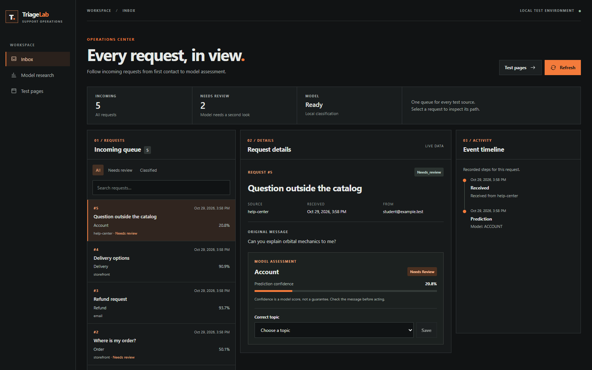
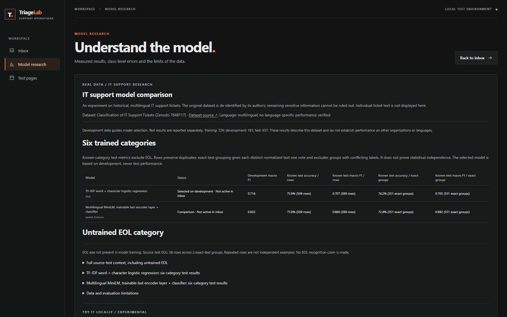
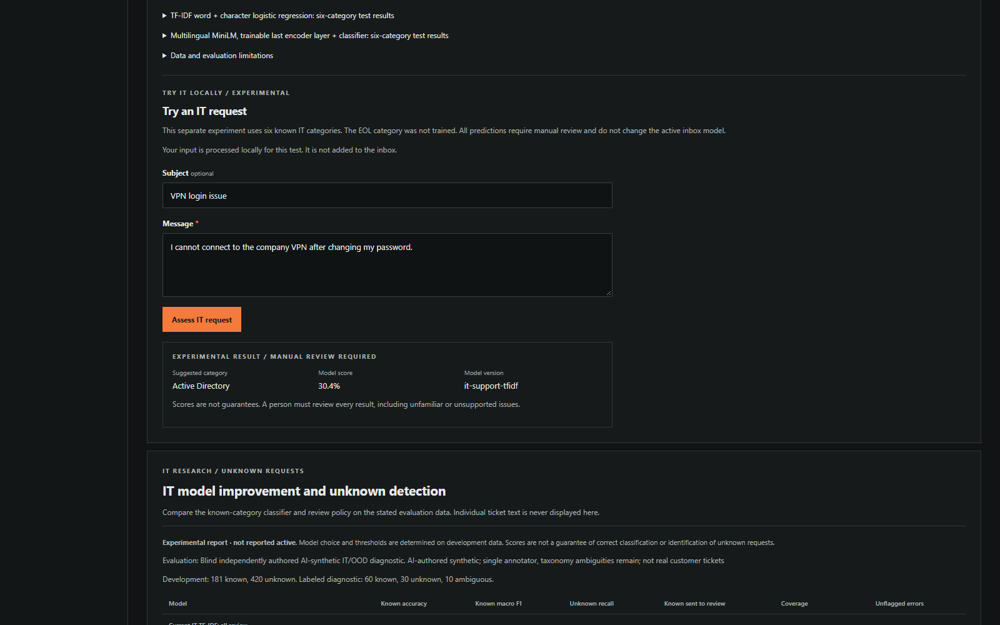
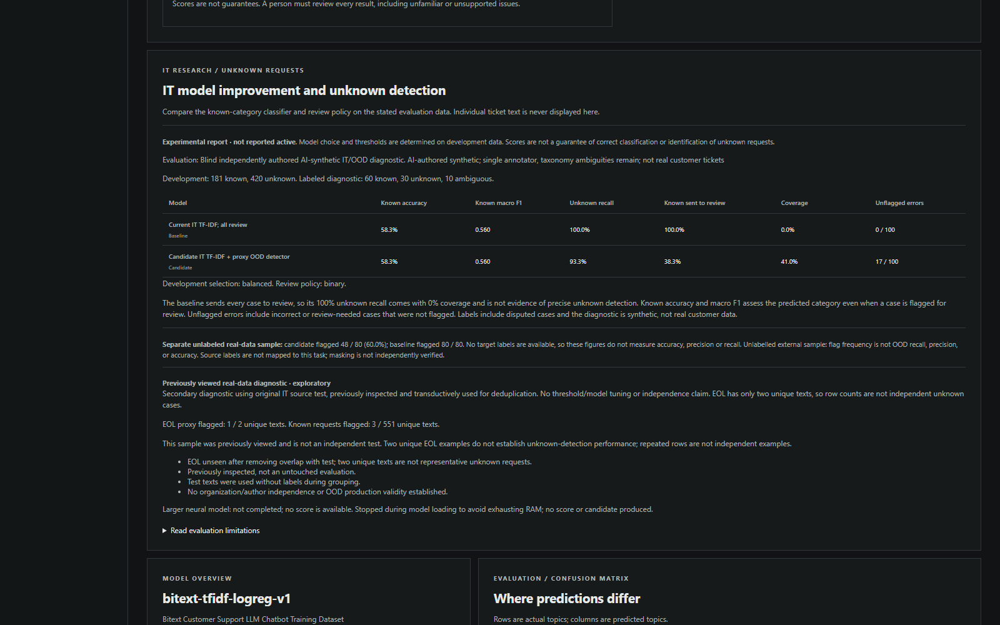
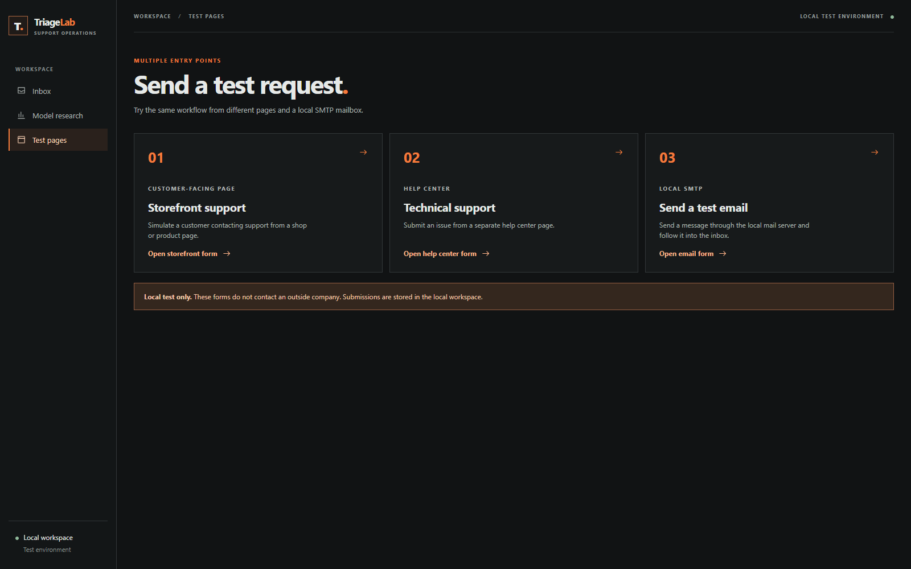
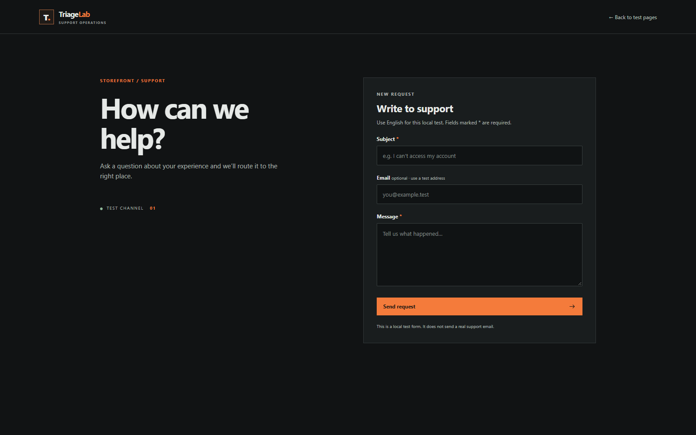
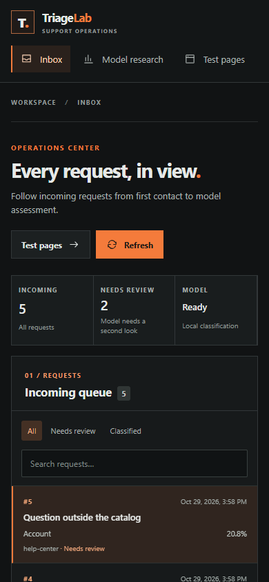
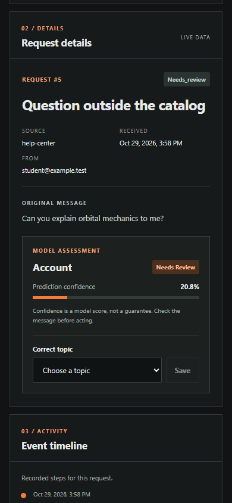

# TriageLab

**A local workbench for studying support-ticket classification and human review.**

TriageLab brings two test forms, a local email inbox, a ticket queue and research results into one application. You can submit a synthetic request, inspect the suggested topic and record a correction. The project also compares models on an independently published IT-ticket dataset and investigates unfamiliar requests.

The useful question is not just whether a classifier can assign a label, but whether a person can inspect the suggestion and understand what the measured results actually support. The application runs locally and is an educational research prototype. Corrections are stored locally; they do not retrain the model.

## See the application

Screenshots show the local application with fictional requests and an isolated test database. The research figures reflect the recorded experiments; the images do not demonstrate delivery through a real email provider.

**Inbox and manual review.** Inspect a request, the model's suggested topic and the reason a second look is needed.



**Model research.** Compare the recorded IT-ticket results and the unsupported EOL category.



**Try an IT request.** Submit text to the separate IT classifier; all suggestions require human review.



<details>
<summary>More screens: unknown requests, test forms and mobile view</summary>

**Unknown-request study:** experimental results and limitations.



**Test pages:** available local request channels.



**Storefront form:** submit a fictional request to the queue.



**Mobile inbox:** queue at a 390-pixel viewport.



**Mobile details:** request and model assessment at a 390-pixel viewport.



</details>

## What you can explore

1. Submit a synthetic request from either test page or send a test email to the local Mailpit inbox.
2. Import messages into the shared queue, inspect the suggested topic and record a correction.
3. Open the research view to compare the synthetic support model, the real-ticket experiment and the experimental unknown-request detector.
4. Try the separate IT classifier. Every IT result requires human review; the experimental detector is not active.

The main inbox and the IT experiment use different trained models and datasets. An inbox topic suggestion is not a prediction from the IT model. Neither workflow automatically routes a request to a real support team.

## Results at a glance

| Evaluation | Result | Interpretation |
| --- | --- | --- |
| Bitext support dataset, 4,804 synthetic test examples | TF-IDF + logistic regression: 99.67% accuracy | Synthetic templates can be similar across splits. This is not real-customer accuracy. |
| IT tickets, 599 known-category test rows | TF-IDF: 75.63% accuracy, 70.71% macro F1; MiniLM: 73.62%, 68.02% | One provider and one split. Test texts contributed to duplicate grouping, so this is not a strictly untouched test. |
| AI-authored unknown-request diagnostic | Experimental detector flagged 28/30 unknown requests and 23/60 known requests | Small synthetic sample; 17/100 wrong or review-needed cases were not flagged. The detector is not enabled. |

EOL was excluded from training during duplicate control and is not a seventh supported category. Its 58 test rows contain only two unique texts, so they cannot establish unknown-request performance. Details and source reports follow below.

## How it works

The browser UI uses a local FastAPI server and SQLite queue. The main classifier combines TF-IDF features with logistic regression. The separate IT study compares TF-IDF against partially fine-tuned multilingual MiniLM. Mailpit simulates an SMTP inbox on the same machine; it does not send mail through a real email provider. The UI is built with Node.js tooling, and training uses Python. Data processing and inference run locally.


## Scope and limitations

This is an educational prototype, not a production help desk. The classifier is TF-IDF plus logistic regression, trained on Bitext's **hybrid synthetic** customer-support dataset. The held-out synthetic test has 4,804 examples; its measured accuracy and macro F1 are in `artifacts/model_report.json` and the interface. Similar templates may appear across splits, so this result is not evidence of performance on real users. Confidence scores are not calibrated probabilities. For this demo, scores below 0.6 are sent to manual review; this operational rule is not a calibrated probability or a reliability guarantee. The unknown-topic check is a limited heuristic: unfamiliar requests can still receive a confident wrong category. Urgency prediction is not implemented.

Mailpit receives local SMTP only. The app polls its local API and imports messages, including HTML-only messages, once using the Mailpit ID. The Mailpit instance is a test inbox; it does not demonstrate delivery through an external mailbox. Attachments are not processed. Mailpit's default retention limit can discard older messages during high-volume tests; it is not a durable production transport. The service must be bound to localhost and must not be exposed publicly: no authentication is implemented. Test data remains in local SQLite and the local mailbox.

## Independent stress evaluation

A second AI agent authored a 60-case synthetic holdout without reading the training or development examples or model outputs. It is a small, single-annotator convenience sample, not a customer study. On the original labels, the active baseline classified 28 of 44 known-topic examples correctly (including cases flagged for review), and flagged 12 of 16 review-needed cases. Five of the 60 cases were incorrect or review-needed but not flagged. In the running prototype `classified` is a status, not an executed routing action.

A character n-gram candidate was compared using a development set and a predeclared gate; it did not pass that gate, so the baseline remains active. The independent test favored the candidate on this small sample, which is a hypothesis to investigate with a new untouched test, not permission to change the selection retroactively. One parcel-tracking label is disputed; the original result and a separately calculated alternative are both retained. The holdout evaluates message text; the live API evaluates subject plus body.

See [stress evaluation](ml/STRESS_EVALUATION.md), [dataset notes](data/holdout_v1.md), [evaluation report](artifacts/stress_report.json), and [sensitivity analysis](artifacts/stress_sensitivity.json). Run the comparison only according to the frozen protocol; reusing this holdout for tuning consumes it.

## Review-detector evolution experiment

A separate review detector was trained on 37,680 fit and 8,420 feedback rows: generated Bitext-based composites plus selected CLINC training prompts. Rows reuse source texts and are not independent real customer requests. G2 is retrained using higher weight on G1 feedback errors. The dev-selected G1 reduced wrong or review-needed cases lacking a flag from 17 to 10 out of 126 synthetic test messages, while unflagged coverage fell from 38/126 to 24/126. Topic classification stayed 52/66. G1 remains experimental and is not active in the app. A separately preserved label sensitivity analysis yields 17 versus 11 unflagged cases; see [evolution method](ml/EVOLUTION.md). The dataset is small and balanced by design; real customer performance remains unknown.

## Real IT support ticket comparison

A separate IT research mode compares a TF-IDF classifier against partially fine-tuned multilingual MiniLM using the same split of [Zenodo IT support tickets](https://zenodo.org/records/7648117), whose author describes the records as real and de-identified. Six categories are trainable after deduplication; EOL is absent from training, and the 58 EOL test rows are only two unique texts. On 599 known-category test rows, TF-IDF achieves 75.63% accuracy / 70.71% macro F1, while MiniLM achieves 73.62% / 68.02%. On 551 unique normalized known texts, accuracies are 74.23% / 72.78%. These figures are descriptive of one provider and split, not a production guarantee. Unlabelled test texts were used to detect overlapping duplicates before training, so the test is not strictly untouched. MiniLM truncates inputs beyond 96 tokens, including 229/657 test rows. The model was selected using development data; the topic model in the original inbox is not replaced.

The **Try an IT request** form uses the selected IT classifier locally and requires human review for every result: unknown-category detection has not been validated. Raw and prepared ticket texts are local-only. Full details, including exact source, licenses, training process and limitations: [data notes](ml/IT_DATA.md), [experiment](ml/IT_EXPERIMENT.md), and [aggregate report](artifacts/it_experiment_report.json).

## IT unknown-request study

A separate experimental detector was trained against limited out-of-scope proxy data. On a 100-message AI-authored synthetic diagnostic, it flagged 28/30 unknown and 23/60 known requests; it left 17/100 wrong or review-needed cases without a review flag. Known-topic classification did not improve: 35/60 in both versions. The active IT preview continues to send all requests for review. A secondary analysis of the previously viewed real IT source test found 1/2 unique unseen EOL texts flagged; this is not a representative independent OOD benchmark. An external real-ticket sample is unlabeled, so no precision or recall can be measured on it. The longer-context MiniLM run was stopped because of low system memory, without producing a score. See [IT v2 experiment](ml/IT_V2_EXPERIMENT.md), [aggregate report](artifacts/it_v2_report.json) and [historical diagnostic](artifacts/it_v2_historical_diagnostic.json).

## Run locally on Windows

The repository does not include model weights, source datasets or a Mailpit binary. Python 3.11 x64, Node.js/npm, internet access for public dependencies and sufficient disk space are required. The full IT model comparison additionally needs CPU PyTorch, the pretrained model and enough RAM; see the guide for sizes and platform-specific requirements.

Follow the [isolated reproduction guide](docs/REPRODUCTION.md) to create a fresh source-only workspace, install dependencies, download the pinned Bitext dataset, train the local classifier, build the frontend and start Mailpit plus the API. It also describes the optional IT experiment. Keep generated datasets, weights, databases and mail local. The guide documents which parts have and have not been checked on a clean installation.

After both local services start, open:

- Application: http://127.0.0.1:8781/
- Mailpit test inbox: http://127.0.0.1:8025/
- Interactive API documentation: http://127.0.0.1:8781/docs

A Python server is required. GitHub Pages cannot execute the backend. The service has no authentication; bind it to localhost and use synthetic messages. Do not load untrusted joblib files.

## API

FastAPI exposes an interactive schema at `/docs`. Examples of local endpoints:

| Endpoint | Purpose |
| --- | --- |
| `GET /api/health` | Check whether the API process responds. |
| `GET /api/tickets` / `POST /api/tickets` | List or create local tickets. |
| `PATCH /api/tickets/{ticket_id}` | Record changes to a ticket, including reviewer feedback. |
| `POST /api/mail/sync` | Import messages from the local Mailpit inbox. |
| `POST /api/it-predict` | Ask the separate IT classifier for a suggestion requiring review. |
| `GET /api/it-experiment` / `GET /api/it-v2` | Read available aggregate IT research results. |

The API does not provide user authentication, a production mail integration or automatic retraining.

## Check

```powershell
.\.venv\Scripts\python.exe -m unittest discover -s tests -v
.\.venv\Scripts\python.exe -m unittest discover -s ml_tests -v
cd frontend
npm test
npm run build
```

Dataset attribution and CDLA Sharing 1.0 terms: [Bitext](https://huggingface.co/datasets/bitext/Bitext-customer-support-llm-chatbot-training-dataset), [data notes](ml/ML_DATA.md). Raw datasets and generated dataset files are excluded. The stress and evolution reports include AI-authored synthetic evaluation examples. Review license requirements before redistributing dataset derivatives.


## Data, attribution and code licensing

- [Bitext customer-support dataset](https://huggingface.co/datasets/bitext/Bitext-customer-support-llm-chatbot-training-dataset): CDLA Sharing 1.0; hybrid synthetic source for the main classifier.
- [IT Support Tickets, Zenodo](https://zenodo.org/records/7648117): CC BY 4.0; source for the six-category comparison. The publisher describes the tickets as de-identified, but this project does not independently verify every record.
- [CLINC150](https://github.com/clinc/oos-eval): CC BY 3.0; selected intents are used as proxy unknowns in the experimental detector.
- [Multilingual MiniLM](https://huggingface.co/sentence-transformers/paraphrase-multilingual-MiniLM-L12-v2): Apache 2.0; pretrained model used for the IT comparison.

These terms apply to their respective resources and do not grant a license to this project's source code. No source-code license has been specified. Consult the source terms before redistributing data or derivatives; raw and prepared ticket texts stay local.
